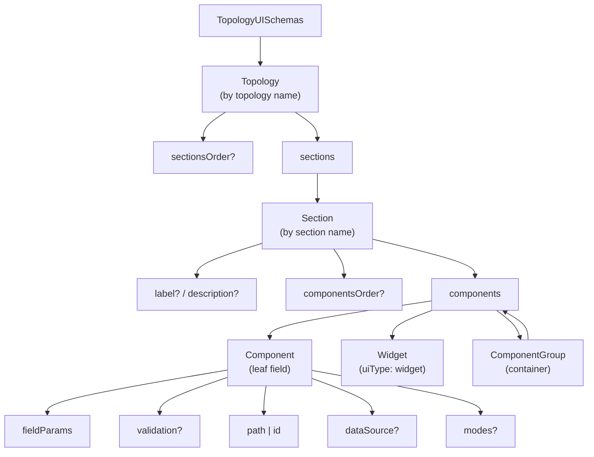
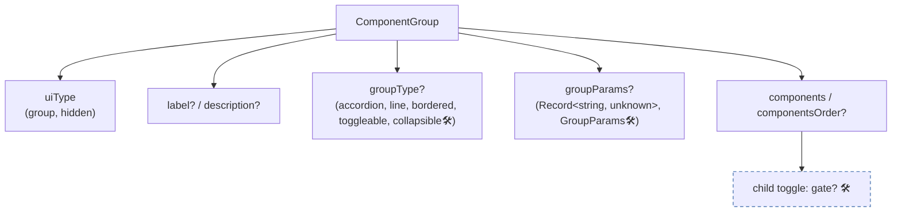
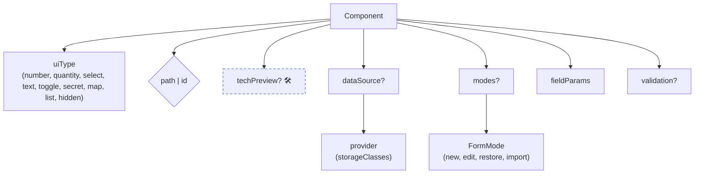
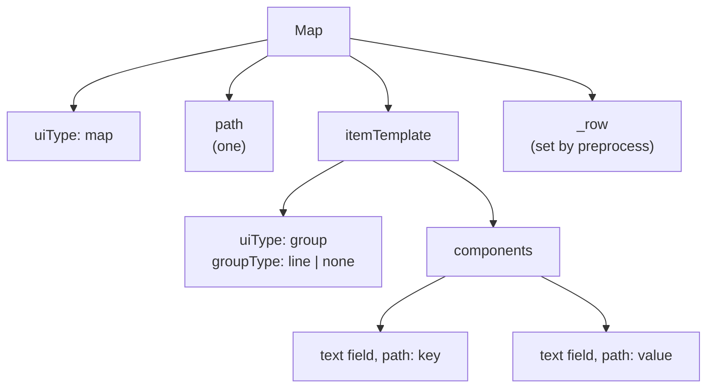
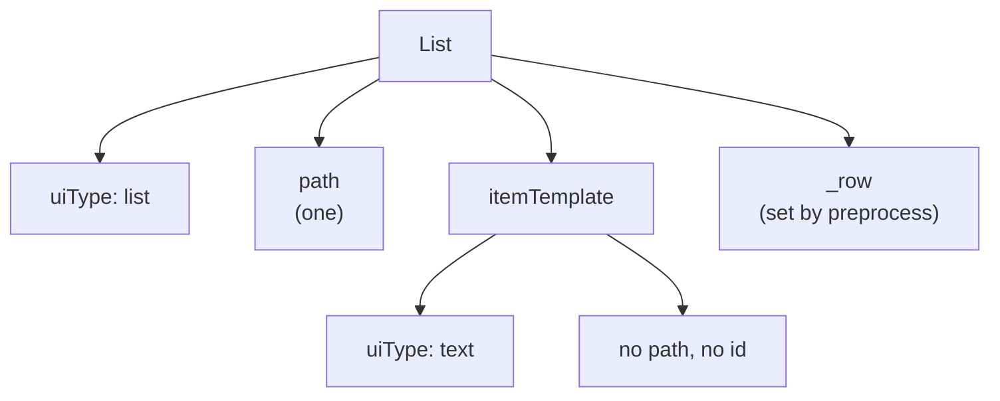
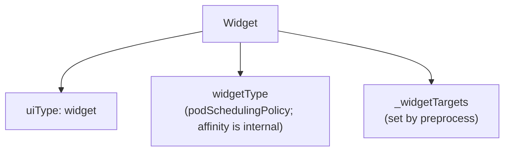
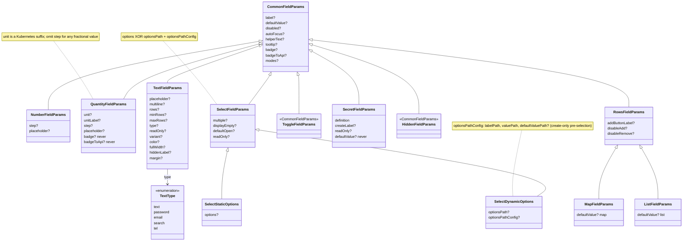
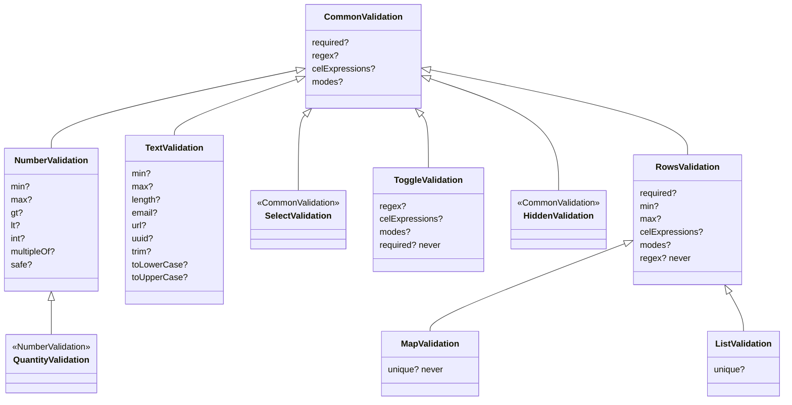

# UI Generator — Schema Reference (props tree)

> Schema props are defined in `ui-generator.types.ts`.
> **Legend:** no marker means implemented; `🛠️` means planned / not implemented yet. In flowcharts, non-implemented nodes also use a dashed border.

Read the diagrams top-down: topology → sections → components (leaf fields) / groups (containers) → their params.

## Overview Map

## Level 2 — ComponentGroup (container)

`gate` 🛠️ is a flag on a child `toggle` (part of the group-kernel proposal, tracked separately).

## Level 2 — Component (leaf field)

- **`path` | `id`** — `path` (`string` | `string[]`) writes to the API; an array is a multi-path (`[0]` is the source, all entries are targets). `id` has no API binding and is used only for validation / CEL.
- **`dataSource.provider`** — a key in the open runtime registry (`register()`), not a closed enum.
- **`modes?`** — `{ [FormMode]: { uiType? } }`; the create wizard runs in `import` when it creates a database from an imported backup.

## Level 2 — Map (repeatable leaf, Tech Preview)

- **The data shape is the `uiType`** — `map` writes `{ key: value }`; `list`, below, writes
  `[value]`. Both are edited as rows by one engine, see
  [Rows fields](pipeline.md#rows-fields-map-and-list).
- **One field, one `path`** — the map writes its whole value to `path`; paths inside a row are the
  row's own (`key`, `value`), never schema paths. A map with several paths is dropped: an edit reads
  only the first.
- **`itemTemplate`** describes one row, written as a group like anywhere else: a mini-section
  whose fields' paths are relative to the row. The container decides what is written: `map` takes
  rows of a field at `key` and a field at `value` and writes an object. Today both are text fields,
  in a `line` group or stacked; a typed value, more fields and nested groups are planned (🛠️). The
  fields are told apart by `path`, so their names are the schema's own. Preprocess prepares the row
  into `_row`, and it renders through the UI Generator, so a text field's params and rules apply,
  transforms included, but for `defaultValue`, badges, CEL and `dataSource`, which the row drops.
- **Ignored options are reported**: what a rendered map can't use (`regex` and `unique` on the
  map, CEL, a `dataSource` or a default / badge on a row's field, a `defaultValue` that isn't a
  map of strings, limits no map meets, limits no form can meet) is ignored at runtime with a dev
  warning (`lintRowsFields`), and the Go validator reports `map-ignored-option` /
  `map-invalid-default` / `map-invalid-limits` / `map-unsatisfiable-limits`.
- **Unique keys** are implied by the map and can't be switched off.
- **Always a row** — a map with no entries is one empty row in the form, given by its codec
  with the form's values and marked as added (see
  [Rows fields](pipeline.md#rows-fields-map-and-list)). It is not an entry, and no lock below
  holds for it; `disableAdd` and `disabled` show it disabled.
- **Row locks** — the form tells the rows it opened with (a saved map's, a default's) from the
  rows the user added since: `RowsField` marks an appended row in the form data
  (`ADDED_ROW_FLAG`), and a form `reset()` with loaded values replaces the rows, mark included.
  A row field's `fieldParams.disabled` / `readOnly` applies to the first kind only: an added row
  is drawn and validated from `toAddedRow`, the row with them cleared. With `disableRemove`
  an emptied row of the first kind is an error rather than dropped. The map's `fieldParams.disableAdd`
  disables the Add button and `disableRemove` the Remove button of the rows the form opened with;
  both can be set per mode in the map's `fieldParams.modes`. The map's own `disabled` disables
  everything. The mark never leaves the form: the codec reads a row's `key` and `value` only.
- **Other shapes are ignored**: preprocess drops a map whose item template it doesn't implement,
  with several paths, or that doesn't own its path, like an unknown `uiType`; the Go validator
  reports `map-unsupported` / `map-multi-path` / `map-overlap`.

## Level 2 — List (repeatable leaf, Tech Preview)

- **A list of strings** — `list` writes `[value, …]` in the order of its rows. A list of objects
  (a group as the item) and typed items are planned (🛠️).
- **One field, one `path`**, as for a map: the list writes its whole value to `path`, and a list
  with several paths is dropped.
- **`itemTemplate`** is one text field, written directly: the field is the entry, so it has no
  `path` or `id`. Preprocess turns it into the same kind of row a map has, in `_row`: a `line`
  group of that one field at `value` (`toListRow`). From there on a list is rows, and everything a
  map's row does applies: the field renders through the UI Generator with a text field's params
  and rules, but for `defaultValue`, badges, CEL, `dataSource` and component-level `modes`, which
  the row drops.
- **The form keeps rows of objects** (`[{ value }]`), since `useFieldArray` holds objects, and the
  codec turns them into the array of strings and back. An empty row is not an entry.
- **Duplicates are allowed**, as an argument list needs them. `validation.unique` forbids them,
  after the item's transforms. A map's keys are always unique: that is where the rules of the
  two differ.
- **The empty row, ignored options, row locks and other shapes** work as for a map, with rules
  named `list-…`: `list-ignored-option` (also `required` on the item, which has nothing to
  check) / `list-invalid-default` (a default that isn't a list of strings) /
  `list-invalid-limits` / `list-unsatisfiable-limits`, and `list-unsupported` /
  `list-multi-path` / `list-overlap`. A map and a
  list on overlapping paths are both dropped, each by its own rule.

## Level 2 — Widget (host-rendered leaf)

- **Supported props:** `uiType: widget` and `widgetType`.
- **`widgetType`** selects the renderer from the consumer's `WidgetRegistry` (edit) and
  `WidgetSummaryRegistry` (`label` + `View` + `digest` for the overview and wizard preview).
  Unknown types render nothing.
- **Location is defined per widget type** — a widget is unique, so there is no shared rule
  for where its data lives:
  - `affinity` (internal) binds one `path`, like a field.
  - `podSchedulingPolicy` is placed without `path` / `id`: preprocess resolves the paths it
    writes per provider and topology (`widgetTargetResolvers`) into `_widgetTargets`, which
    toggleable groups, payload merging and the overview read.

## Level 3 — fieldParams (by field type)

## Level 3 — validation (by field type, mode-aware)

- **modes (mode-aware)** — `{ [FormMode]: <same rules> + inheritShared? }`.
- **`toggle`** — `required` is always optional (`never`).
- **`select` / `hidden`** — common rules only.
- **`secret`** — `text` rules; the value is the Secret's name.
- **`quantity`** — same numeric rules as `number`; bounds and CEL see the number in `unit`.
- **`map`** — rules on the count of filled rows; `required` means at least one. A count issue
  sits at the map's `root`, beside its rows' issues, and so does the issue of a CEL rule set
  on the map. A rule, on the map or on another field, reads the map by its path as the map it
  writes (unset when it has no entries). A rule on a row's field waits for `self`.
  The limits
  are `min` / `max`, the names `text` and `number` use for their own size; OpenAPI's
  `minProperties` / `maxProperties` stay in the API schema.
- **`list`** — the same rules, read the same way: counts of filled rows, issues at the list's
  `root`, a CEL rule reading the list by its path as the array of strings it writes (unset when
  it has no entries). `unique` forbids a value set twice, and its issue sits on the later row.
  OpenAPI's `minItems` / `maxItems` / `uniqueItems` stay in the API schema.

## Reserved Keys

A key starting with `_` on a component is the engine's: preprocess derives `_normalized`, `_row`,
`_toggleable` and `_widgetTargets`, and `RowsField` sets `_renderOverrides` on the row fields it
renders, a map's or a list's. `stripEngineKeys` drops any such key a schema sets before anything reads it, and the Go
validator reports it (`reserved-key`).

## Cross-Cutting Concepts

| Concept                        | Meaning                                                                                                                                                                                                                          | Status      |
| ------------------------------ | -------------------------------------------------------------------------------------------------------------------------------------------------------------------------------------------------------------------------------- | ----------- |
| **FormMode**                   | `new · edit · restore · import` controls `modes` at three levels: component `uiType`, `fieldParams`, and `validation`                                                                                                            | implemented |
| **multi-path**                 | `path: [a, b]` writes the same value to all targets                                                                                                                                                                              | implemented |
| **dataSource / API providers** | `dataSource: { provider }` names an API-backed option source; preprocess dev-validates the provider key, and at runtime `DataSourceField` loads the options through the registry (`DataSourcePrefetcher` sets defaults on mount) | implemented |
| **CEL validation**             | Cross-field validation rules declared via `celExpressions` (with an `original` namespace available in edit mode)                                                                                                                 | implemented |
| **CEL conditional rendering**  | Show / hide fields based on another field value through a generic mechanism                                                                                                                                                      | 🛠️          |
| **group kernel**               | `bordered`, `toggleable` (form-only switch); planned: `collapsible`, persisted `gate` ([#3290](https://github.com/openeverest/openeverest/issues/3290)), `direction`                                                             | partial     |

## To Consider

- **Disabling a group (including a toggleable switch)** — covered by group-level `modes` (`hidden` / `disabled` per form mode) in [#3080](https://github.com/openeverest/openeverest/issues/3080). Conditional disabling via CEL depends on [#1837](https://github.com/openeverest/openeverest/issues/1837).
- **`fieldParams.badge` / `badgeToApi`** — inherited by most field types through `CommonFieldParams`; visual badge rendering is supported for `number` and `select`, while `text` / `toggle` / `hidden` have asymmetric behavior. **`quantity` forbids both** (`never`) and skips them in `extractBadgeMappings` — use `unit` / `unitLabel` instead.

  When `badgeToApi` is set on a `number` (or other non-quantity) field, the badge also acts as the value's **unit**: applied on write and converted back on read by `stripBadgeFromValue` (`badge-to-api`), which the overview cards reuse for display. The unit semantics, conversion rules and supported-unit list are documented for users in [number-field](../../ui-generator/components/number-field.md#unit-badge). For resource quantities prefer [quantity-field](../../ui-generator/components/quantity-field.md).

## Metadata

- Owner: UI
- Status: current
- Last updated: 2026-11-27
