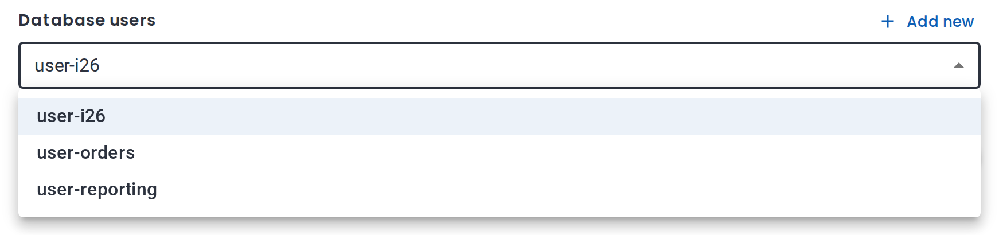
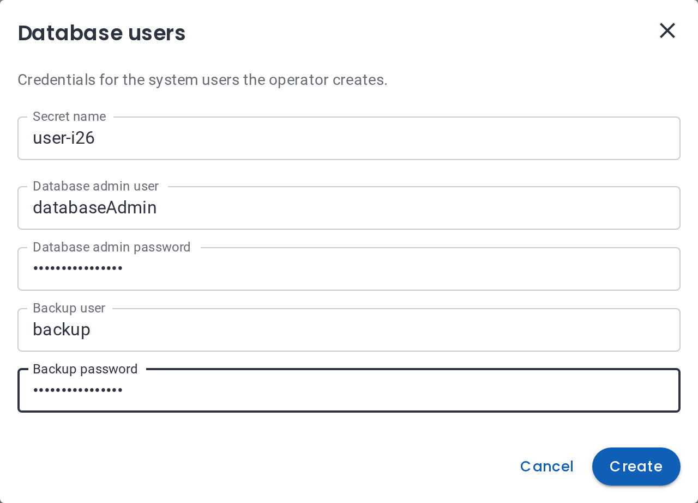
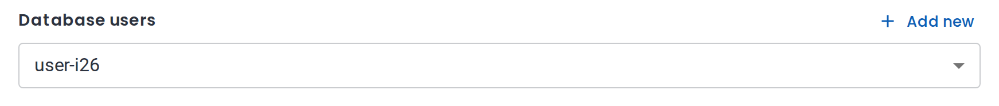
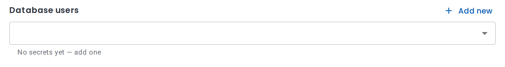

# SecretField

## Table of Contents

- [Properties](#properties)
- [Create Form](#create-form)
- [Examples](#examples)
  - [Basic Secret Field](#basic-secret-field)
  - [Create Form for a Definition](#create-form-for-a-definition)
  - [Per-Mode Behavior](#per-mode-behavior)
- [Behavior](#behavior)

A select of the provider's Secrets of one secret definition, with a button that creates a new
Secret in a dialog. The field's value is the selected Secret's name.



## Properties:

- `uiType`: `"secret"` (**Required**)
- `path`: Where the Secret's name is written, e.g. `spec.userSecretRef.name` (**Required**)
- `fieldParams`: Configuration object with the following properties:
  - `definition`: Key of the provider's `spec.secrets` entry the Secrets belong to (**Required**)
  - `label`: Display label, shown above the select
  - `createLabel`: Text of the button that opens the create dialog (default: `Add new`)
  - `helperText`: Help text displayed below the field. Status messages, such as
    "No secrets yet", replace it.
  - `defaultValue`: Secret name selected initially
  - `disabled`: Whether the field is disabled (default: `false`)
  - `readOnly`: Show the selected name without listing Secrets (default: `false`)
  - `modes`: Per-mode overrides, see [FieldParams-level modes](../Readme.md#fieldparams-level-modes)
- `validation` (optional): Rules for the Secret's name, the same as for a
  [text field](text-field.md) — usually just `required`.

## Create Form

The dialog behind the create button is rendered from the definition's `uiSchema` on the
Provider, `spec.secrets.<definition>.uiSchema`. A provider built with the provider SDK keeps it in
`definition/secrets/<definition>/ui.yaml`. Without a `uiSchema`, the field only lists existing
Secrets.

The `uiSchema` is one section — `label`, `description`, `components` and `componentsOrder` — whose
components are regular fields. A component's `path` is a key of the Secret's data, see
[Path scoping](../Readme.md#path-scoping).

The dialog adds a **Secret name** field, prefilled with `<definition>-<random suffix>`. A name
contains only lowercase letters, numbers and hyphens, doesn't start with a hyphen or a number,
doesn't end with a hyphen, and is at most 22 characters long.



**Create** saves the Secret right away and selects it in the field. The Secret gets:

- the labels `openeverest.io/provider: <provider>` and `openeverest.io/definition: <definition>`,
  which put it in the field's list;
- the form values as `stringData`; number and toggle values are stored as their JSON text.



If the name is taken, the name field shows an error and nothing is saved. Cancelling the wizard
afterwards doesn't delete a created Secret.

## Examples:

### Basic Secret Field

```yaml
userSecret:
  uiType: secret
  path: spec.userSecretRef.name
  fieldParams:
    label: Database users
    definition: user
    helperText: Leave empty to generate the credentials
```

### Create Form for a Definition

`definition/secrets/user/ui.yaml`:

```yaml
label: Database users
description: Credentials of the users the operator creates.
components:
  adminUser:
    uiType: text
    path: MONGODB_DATABASE_ADMIN_USER
    fieldParams:
      label: Database admin user
      defaultValue: databaseAdmin
    validation:
      required: true
  adminPassword:
    uiType: text
    path: MONGODB_DATABASE_ADMIN_PASSWORD
    fieldParams:
      label: Database admin password
      type: password
    validation:
      required: true
componentsOrder:
  - adminUser
  - adminPassword
```

Use `type: password` for passwords: the input is masked, and the browser doesn't autofill it.

### Per-Mode Behavior

```yaml
userSecret:
  uiType: secret
  path: spec.userSecretRef.name
  fieldParams:
    label: Database users
    definition: user
    modes:
      edit:
        readOnly: true
  modes:
    restore:
      uiType: hidden
```

The field is optional on create, read-only on edit, and hidden on restore.

## Behavior:

- **List**: Secrets in the instance's namespace that carry the provider and definition labels.
  Secrets being deleted are hidden.
- **Create button**: shown when the definition has a `uiSchema`, the user may create Secrets in the
  namespace, and the field is editable. It is hidden in edit mode.
- **Value not in the list** (e.g. from a preset or `defaultValue`): kept and shown as
  `<name> (not managed by OpenEverest)`.
- **Read-only or disabled**: shows the selected name; no list is requested.
- **Empty list**: "No secrets yet", or "No secrets yet — add one" when the create button is shown.

  

- **Namespace switch** in the create wizard: a selected Secret the new namespace doesn't have is
  cleared.
- **No provider or namespace** (e.g. a schema playground): the field is disabled.
